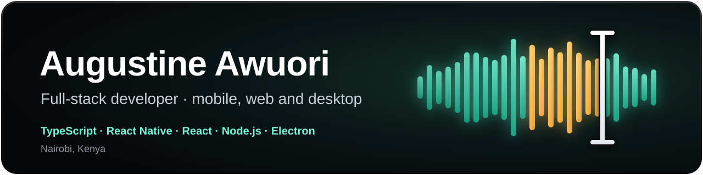
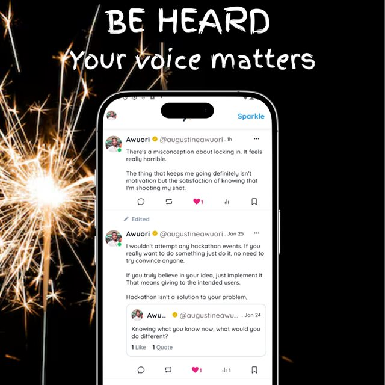
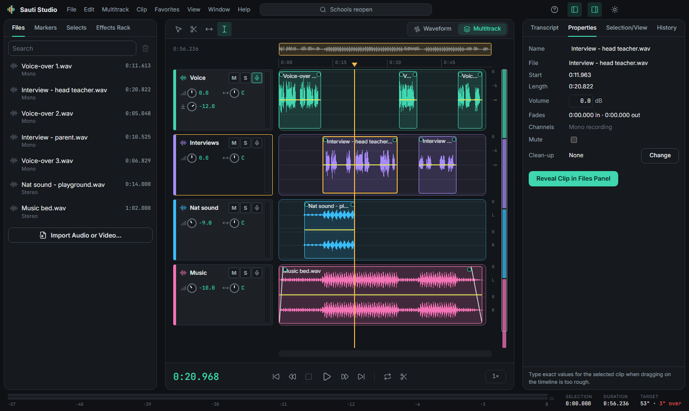

  
  
  
  

## Hi, I'm Augustine 👋

I'm a full-stack developer in Nairobi. I build products end to end, from the database to the app in someone's hand, and I keep them running after launch.

- 📱 I'm the **lead developer of [Sparkler](https://www.sparkler.co.ke)**, a social network for university students. It has an Android app on Google Play, a web app and an API.
- 🎙️ I'm building **[Sauti Studio](https://the-editors-two.vercel.app/sauti-studio/)**, a desktop audio editor that lets journalists edit interviews by their transcript, offline.
- 💼 **I'm open to new roles.** Write to me at **codewithaugustine@gmail.com**.

## Featured work

###  Sparkler: the campus feed for students

Students at Kisii University use it to post, discuss what matters to them and join communities, under their real name or an alias. I lead development across all of its parts:

- **Mobile app** (React Native, Expo): feeds, chat, communities, push notifications, and Google and Apple sign-in. It's on version 3, built with EAS and published on [Google Play](https://play.google.com/store/apps/details?id=sparkler.website) (100+ installs).
- **Web app** (React, TanStack Start, Tailwind CSS, Supabase) at [sparkler.co.ke](https://www.sparkler.co.ke).
- **API** (Node.js, Express, MongoDB, Zod, JWT), tested with Vitest and Supertest. [Source code ↗](https://github.com/augustine-awuori/sparkler-api)
- **Error tracker**: when Bugsnag started asking for a paid plan, I built our own. It groups crashes from both apps, shows who was affected, assigns each error to someone and flags errors that come back after a fix.

  
  

###  Sauti Studio: a voice editor for journalists

*Sauti* is Kiswahili for "voice". This desktop app for Windows and macOS cuts interviews, cleans up voices and exports at broadcast loudness. It keeps Adobe Audition's names, layout and shortcuts, so people switching from it don't have to relearn anything. Nothing is uploaded: everything runs on the user's computer.

- **Edit by transcript:** offline speech-to-text with whisper.cpp in 10 languages, including Kiswahili, Somali and Amharic. Deleting words cuts the audio, and each cut lands in the quiet between words.
- **Clean up a voice in one click:** noise, harsh "s" sounds, pops, clicks and mains hum. Then export at broadcast loudness, measured to EBU R128 / BS.1770.
- **In three languages:** the interface is in English, Kiswahili and French.
- **How it's built:** Electron, React 19, TypeScript and Zustand. Every edit is an Immer patch, so undo comes for free. Playback (in an audio worklet) and export share one mixer, so the exported file sounds exactly like what was heard. The domain logic and the audio engine are pure TypeScript, tested with Vitest. FFmpeg and whisper.cpp sit behind adapters, so tests can swap them for fakes. Mac builds run on GitHub Actions.

[Download](https://the-editors-two.vercel.app/sauti-studio/) · [Features](https://the-editors-two.vercel.app/sauti-studio/features/) · [Releases](https://github.com/augustine-awuori/sauti-studio-releases)

### More projects

| Project | What it is | Built with |
| --- | --- | --- |
| [**The Editors**](https://the-editors-two.vercel.app) | The website where Sauti Studio is downloaded. React renders every page when the site is built, so the pages work without JavaScript. It has a strict content security policy, and a check drives the built site in Edge before each release. | React, Vite, TypeScript, Playwright, Vercel |
| [**Campus Mart**](https://github.com/augustine-awuori/amazing) | A marketplace where Kisii University students buy and sell, with real-time updates and notifications. | React, TypeScript, Chakra UI, Firebase |
| [**Learn Kenyan Languages**](https://github.com/augustine-awuori/LearnKenyanLanguages) | A website for learning Kenya's languages. | JavaScript |
| [**Kisii University Alumni**](https://github.com/augustine-awuori/kisii-alumnis) | A site that collects alumni details. | TypeScript |
| [**Node.js**](https://github.com/augustine-awuori/nodejs-starter-ts) and [**React**](https://github.com/augustine-awuori/react-starter-vite-ts) starters | Templates to clone and start coding at once: Express with TypeScript, and React with Vite and TypeScript. | TypeScript |

## How I work

- **Types and tests at every layer.** I use strict TypeScript, and Vitest from the API (Supertest, with an in-memory MongoDB) to the apps and the audio engine.
- **Clients and API change together.** A change updates the mobile app, the web app and the API at the same time. The API stays backward-compatible until older installed versions of the app are gone.
- **Design for the habits people already have.** I work out what the user is trying to get done, then keep the names, layouts and shortcuts they already know.
- **Code that is easy to swap and test.** Each module has one job, and external services sit behind adapters, so they can be replaced or faked in tests.

## Tech stack

| Area | Tools |
| --- | --- |
| **Languages** |     |
| **Mobile** |    |
| **Web** |     |
| **Backend** |      |
| **Desktop** |    |
| **Testing** |    |
| **Shipping** |     |

---

📫 Say hello at <a href="mailto:codewithaugustine@gmail.com">codewithaugustine@gmail.com</a> or <a href="https://x.com/awuoriaugustine">@awuoriaugustine</a>.

